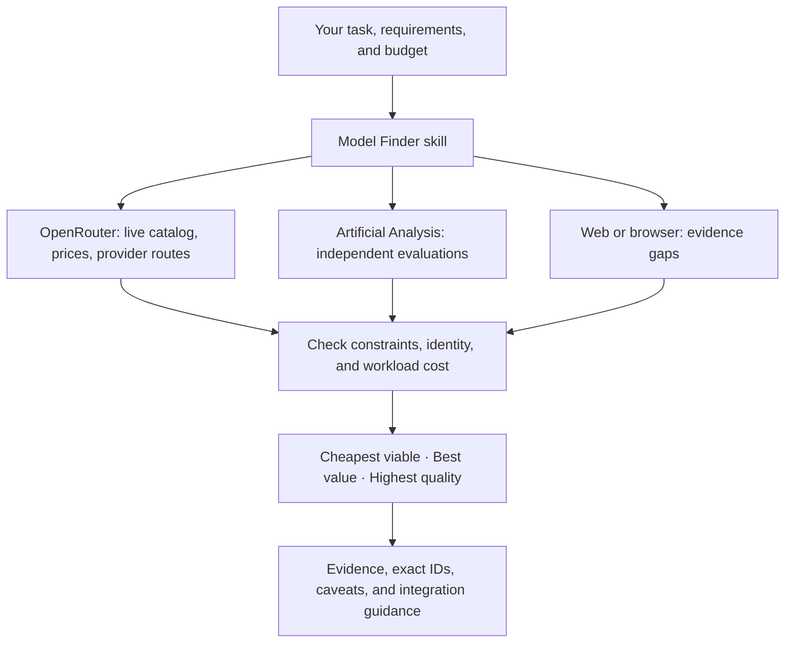

# Model Finder

**The right model for the task. Live prices. Independent evidence.**

An Agent Skill and plugin for Claude Code, Codex, and OpenCode that helps people—and the agents building their applications—choose AI models using current OpenRouter data and Artificial Analysis benchmarks.

Ask for the cheapest viable model, the strongest coding model within a budget, or a better quality/cost tradeoff. Get exact model IDs, workload costs, evidence, and the limits of the recommendation.

```text
I’m building an agentic RAG system with tool calling and JSON Schema outputs.
Find the three best-value models on OpenRouter with at least 128K context.
Estimate cost for 3,000 input + 500 output tokens and 100,000 requests/month.
Compare independent benchmarks and include promising recent releases.
```

## How it works



- **Current by design.** Research the live catalog each session; no maintained list of supposedly best models.
- **Task before ranking.** Filter tools, schema support, modalities, context, output limits, and budgets before comparing quality.
- **Cost for your workload.** Input and output prices, per-request cost, and monthly estimates—not just the cheaper input sticker price.
- **Honest evidence.** No fuzzy benchmark joins, invented scores, or claims that an untested new model is production-ready.
- **Useful inside coding workflows.** Recommend a model and, when requested, integrate its verified ID into application code.

The skill guides research using existing MCP servers. It does not run a new service or automatically change the coding agent's own model. The optional Python helper makes calculations reproducible and never calls inference.

## Quick start

Choose **one installation route per client**. Loading both the plugin and a copied skill can create duplicate entries.

### Claude Code plugin

From this checkout:

```bash
claude --plugin-dir .
```

Then use `/model-finder:model-finder`. The plugin bundles both research MCP endpoints; authenticate through `/mcp` as prompted. For persistent local marketplace installation, see [setup](docs/setup.md#claude-code-plugin).

### Codex or OpenCode skill

With Python 3.10+:

```bash
python scripts/install.py --target codex
# Or:
python scripts/install.py --target opencode
```

For Claude's standalone `/model-finder` command, use `--target claude`. Windows users can also run `./install.ps1 --target codex`; macOS/Linux users can run `bash install.sh --target codex`. Installers copy the full skill, refuse to replace existing installations, and leave MCP settings alone. A [manual copy](docs/setup.md#manual-installation-no-python) needs no Python.

Connect OpenRouter once for the client you use:

```bash
# Codex
codex mcp add openrouter --url https://mcp.openrouter.ai/mcp
codex mcp login openrouter

# Claude Code, when using the standalone skill
claude mcp add --transport http --scope user openrouter https://mcp.openrouter.ai/mcp
claude mcp login openrouter
```

OpenCode uses an `mcp` configuration entry and `opencode mcp auth openrouter`; see the [complete setup](docs/setup.md), including Artificial Analysis, project scope, Codex plugin packaging, optional browser access, and troubleshooting. OpenRouter already exposes third-party benchmark tools, so a separate Artificial Analysis connection is optional.

### Ask

**Claude standalone skill:**

```text
/model-finder Find the cheapest viable model for structured document extraction.
Require JSON Schema outputs and compare current OpenRouter prices and evidence.
```

**Codex:**

```text
$model-finder Compare current models for Python code generation.
Prioritize quality per dollar. Explain benchmark coverage for recent releases.
```

**OpenCode:**

```text
Use the model-finder skill. Recommend a fast tool-calling model for my app.
Check provider endpoints and explain the cost at 50,000 requests/month.
```

## A useful recommendation, with its limits

Expect a verdict and a short comparison of exact IDs, task-relevant evidence, input/output $ per million tokens, workload cost, context, and provider limitations. The skill distinguishes the cheapest advertised match from a model with established task fitness. It reports missing evidence and cites the sources it used.

"Best value" depends on the task. Comparable benchmark scores can identify the quality/cost Pareto frontier; the agent explains which tradeoff suits your requirements. A benchmark index alone does not prove JSON reliability, agent performance, or accuracy on your own data.

Research does not imply permission for paid test prompts or uploading private code. The skill uses existing authorization or obtains it before an evaluation. API data access can have its own quota and subscription costs.

## Optional helper

No dependencies beyond Python 3.10+. It can fetch the public OpenRouter catalog without an API key, filter exact capabilities, and estimate costs. Use it when MCP is unavailable or you want reproducible arithmetic.

```bash
python skills/model-finder/scripts/model_finder.py fetch --output .model-finder/catalog.json
python skills/model-finder/scripts/model_finder.py shortlist --catalog .model-finder/catalog.json --require tools --require structured_outputs --min-context 131072 --exclude-free --limit 5
```

Try a completely offline demonstration with fictional models:

```bash
python skills/model-finder/scripts/model_finder.py shortlist --catalog examples/catalog.example.json --benchmarks examples/benchmarks.example.json --objective value
```

For those synthetic examples, the frontier contains `example/budget`, `example/balanced`, and `example/premium`; the more expensive, lower-scoring `example/dominated` is excluded from the frontier. These are not real models or current benchmarks. See the [helper reference](skills/model-finder/references/helper.md) for benchmark mappings, JSON output, all ranking modes, and cost assumptions.

## Repository

```text
skills/model-finder/       Shared Agent Skill, references, and standalone helper
.claude-plugin/           Claude plugin manifest and local marketplace
.codex-plugin/            Codex compatibility plugin manifest
.agents/plugins/          Native Codex marketplace entry
.mcp.json                 Official research MCP endpoints; no credentials
examples/                 OpenCode config and clearly synthetic demo data
scripts/                  Installer, repository validation, release packaging
tests/                    Offline behavior and integration tests
docs/                     Setup and design decisions
.github/                  CI, issue templates, and pull request template
```

Everything is self-contained. `Initial Work/` is preserved locally and ignored by Git; you can delete it without affecting the project. No files depend on it.

## Development

```bash
python -m unittest discover -s tests -v
python scripts/validate.py
python scripts/package.py
```

CI runs offline checks on Windows, macOS, and Linux with Python 3.10 and 3.13, then builds an installable ZIP. There are no live API calls in CI. Read [CONTRIBUTING.md](CONTRIBUTING.md) for changes and [docs/design.md](docs/design.md) for the architecture and current boundaries.

The repository is ready for your own GitHub remote; no account, repository URL, or release is assumed. Commit and push when you are ready. The ZIP builder uses an allowlist and excludes local notes, credentials, caches, and live data snapshots.

## Sources and license

Integration formats and endpoints were checked on **2026-10-24** against the official [OpenRouter MCP documentation](https://openrouter.ai/blog/announcements/openrouter-mcp-server/), [Artificial Analysis MCP documentation](https://artificialanalysis.ai/data-api/docs/mcp), [Claude plugin reference](https://code.claude.com/docs/en/plugins-reference), [Codex skill documentation](https://learn.chatgpt.com/docs/build-skills), [OpenAI plugin packaging](https://developers.openai.com/plugins/build/plugins), and [OpenCode skill documentation](https://opencode.ai/docs/skills/). Client support and provider APIs can change; setup links point to the maintained sources.

MIT for the code and skill. Provider data, benchmarks, trademarks, and services retain their own terms. This is an independent project, not affiliated with those providers.
