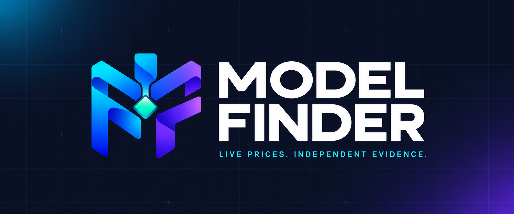
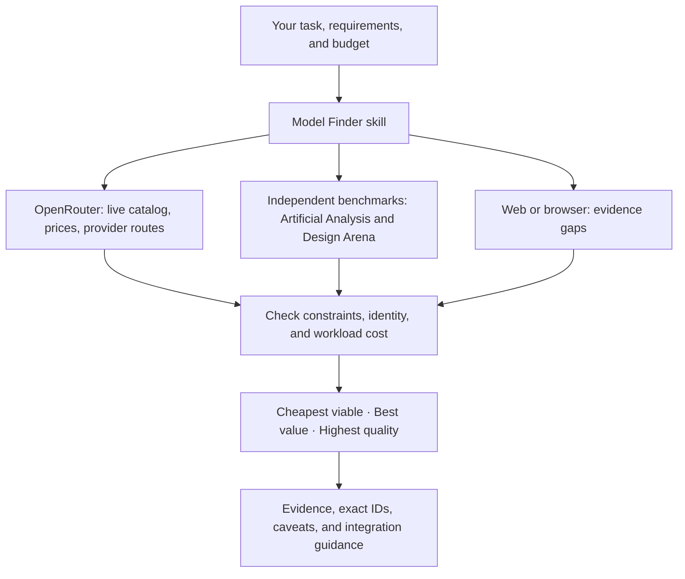

<p align="center">
  
</p>

<p align="center">
  <strong>Find the right model for your next task.</strong><br>
  Live model discovery and evidence-based recommendations for Claude Code, Codex, and OpenCode.
</p>

<p align="center">
  <a href="#quick-start">Quick start</a> ·
  <a href="#ask">Examples</a> ·
  <a href="#how-it-works">How it works</a> ·
  <a href="docs/setup.md">Documentation</a> ·
  <a href="CONTRIBUTING.md">Contributing</a>
</p>

<p align="center">
  <a href="LICENSE"></a>
  <a href=".claude-plugin/plugin.json"></a>
  <a href="#optional-helper"></a>
  <a href="docs/setup.md#connect-research-data"></a>
</p>

<p align="center">
  <a href="docs/setup.md#claude-code-plugin"></a>
  <a href="docs/setup.md#codex-plugin"></a>
  <a href="docs/setup.md#opencode"></a>
</p>

---

Model releases move quickly. Model Finder helps you choose using **current OpenRouter prices, capabilities, provider routes, and independent benchmark evidence**. Describe your task and budget; get exact model IDs, estimated workload costs, and a recommendation with its tradeoffs explained.

| Your priority | What Model Finder checks |
| --- | --- |
| **Cheapest viable** | Price after required capabilities, context, and task evidence are considered |
| **Best value** | The quality gained for the extra workload cost |
| **Highest quality** | Relevant measured capability within your constraints |
| **Fastest** | Available endpoint latency and throughput evidence |
| **Recent releases** | New catalog additions, with benchmark coverage gaps called out |

Use it directly when choosing a model, or let your coding agent use it while building an application. The shared Agent Skill combines OpenRouter, Artificial Analysis, and relevant Design Arena evidence. MCP handles live research; an optional Python helper makes catalog filtering and cost calculations reproducible.

> A recommendation includes uncertainty. Missing benchmarks stay unknown, model IDs are verified, and advertised capabilities are checked against provider routes. Model Finder does not automatically switch its host agent's model or run paid inference.

## Quick start

**Before you begin:** install and sign in to your coding client, have an OpenRouter account, and install Python 3.10+ for the installer. No pip packages are needed. Prefer to copy files? Use the [manual installation instructions](docs/setup.md#manual-installation-no-python).

Download this repository using **Code → Download ZIP** and extract it, or clone it. Open a terminal in the folder containing this `README.md` and `scripts/`.

Follow the section for your client: **[Claude Code](#claude-code)** · **[Codex](#codex)** · **[OpenCode](#opencode)**.

The examples use `python`. If needed, use `python3` on macOS/Linux or `py -3` on Windows instead. Installation is for your user account, so the skill can be used across projects.

### Claude Code

**1. Install the skill and connect OpenRouter.** Run in your terminal:

```bash
python scripts/install.py --target claude
claude mcp add --transport http --scope user openrouter https://mcp.openrouter.ai/mcp
claude mcp login openrouter
```

**2. Finish the browser login.** Then open a new Claude Code session in your project. If your Claude version does not have `mcp login`, enter `/mcp` inside Claude Code and authenticate OpenRouter there.

**3. Ask inside Claude Code:**

```text
/model-finder Find the cheapest viable model for tool calling and JSON Schema output.
Use current OpenRouter prices and independent benchmarks.
```

### Codex

**1. Install the skill and connect OpenRouter.** Run in your terminal:

```bash
python scripts/install.py --target codex
codex mcp add openrouter --url https://mcp.openrouter.ai/mcp
codex mcp login openrouter
```

**2. Finish the browser login.** Then open a new Codex session in your project.

**3. Ask inside Codex:**

```text
$model-finder Find the best-value model for Python code generation.
Compare live OpenRouter prices and independent coding benchmarks.
```

### OpenCode

**1. Install the skill.** Run in your terminal:

```bash
python scripts/install.py --target opencode
```

If you already installed this skill for Claude Code or Codex, OpenCode can discover that copy; skip installing another copy.

**2. Add OpenRouter to your OpenCode config.** Create `~/.config/opencode/opencode.json` with the following content, or merge the `mcp.openrouter` entry into your existing config. A project-level `opencode.json` also works. Keep your other settings.

```json
{
  "$schema": "https://opencode.ai/config.json",
  "mcp": {
    "openrouter": {
      "type": "remote",
      "url": "https://mcp.openrouter.ai/mcp",
      "enabled": true
    }
  }
}
```

**3. Authenticate.** Run in your terminal and finish the browser login:

```bash
opencode mcp auth openrouter
```

**4. Open a new OpenCode session and ask:**

```text
Use the model-finder skill. Find three low-cost models for my RAG app.
Require tool calling and compare current prices and benchmark evidence.
```

### Optional setup and troubleshooting

- **Already connected?** Skip `mcp add` if OpenRouter is already configured in that client; authenticate if needed.
- **Want the native plugin?** Follow the [Claude Code plugin](docs/setup.md#claude-code-plugin) or [Codex plugin](docs/setup.md#codex-plugin) instructions instead of installing a second copy of the skill. The Claude plugin command is `/model-finder:model-finder`.
- **Artificial Analysis:** OpenRouter already exposes third-party benchmarks. A separate [Artificial Analysis connection](docs/setup.md#artificial-analysis-optional-independent-connection) is optional.
- **Other Agent Skills clients:** copy the complete `skills/model-finder/` folder into that client's documented skill directory, then connect a supported live data source.
- **Install or login trouble?** See [setup and troubleshooting](docs/setup.md#check-the-setup). The installer leaves existing skills untouched; move an old `model-finder` folder aside before upgrading.

### Ask

Describe your actual workload for a more useful comparison:

```text
I’m building an agentic RAG system with tool calling and JSON Schema outputs.
Find the three best-value models on OpenRouter with at least 128K context.
Estimate cost for 3,000 input + 500 output tokens and 100,000 requests/month.
Compare independent benchmarks and include promising recent releases.
```

Start with your client's invocation shown above, then describe the workload. If you do not know token counts or volume yet, the skill can use clearly labeled assumptions.

## How it works



## A useful recommendation, with its limits

Expect a verdict and a short comparison of exact IDs, task-relevant evidence, input/output $ per million tokens, workload cost, context, and provider limitations. The skill distinguishes the cheapest advertised match from a model with established task fitness. It reports missing evidence and cites the sources it used.

"Best value" depends on the task. Comparable benchmark scores can identify the quality/cost Pareto frontier; the agent explains which tradeoff suits your requirements. A benchmark index alone does not prove JSON reliability, agent performance, or accuracy on your own data.

Research does not imply permission for paid test prompts or uploading private code. The skill uses existing authorization or obtains it before an evaluation. API data access can have its own quota and subscription costs.

## Optional helper

No dependencies beyond Python 3.10+. It can fetch the public OpenRouter catalog without an API key, filter exact capabilities, and estimate costs. Use it when MCP is unavailable or you want reproducible arithmetic.

```bash
python skills/model-finder/scripts/model_finder.py fetch --output .model-finder/catalog.json
python skills/model-finder/scripts/model_finder.py shortlist --catalog .model-finder/catalog.json --require tools --require structured_outputs --min-context 131072 --exclude-free --limit 5
```

With a regular `OPENROUTER_API_KEY` set in the environment, fetch benchmark evidence directly:

```bash
python skills/model-finder/scripts/model_finder.py benchmarks --source artificial-analysis --task-type coding --output .model-finder/benchmarks.json
```

This preserves source citations and dataset dates. Benchmark IDs still need verification against the live catalog before use. For replacement decisions based on existing traffic, the skill can also use authorized usage aggregates; see the optional [usage workflow](skills/model-finder/references/usage.md). Analytics access is separate from model discovery.

Try a completely offline demonstration with fictional models:

```bash
python skills/model-finder/scripts/model_finder.py shortlist --catalog examples/catalog.example.json --benchmarks examples/benchmarks.example.json --objective value
```

For those synthetic examples, the frontier contains `example/budget`, `example/balanced`, and `example/premium`; the more expensive, lower-scoring `example/dominated` is excluded from the frontier. These are not real models or current benchmarks. See the [helper reference](skills/model-finder/references/helper.md) for benchmark mappings, JSON output, all ranking modes, and cost assumptions.

## Repository

```text
skills/model-finder/       Shared Agent Skill, references, and standalone helper
.claude-plugin/           Claude plugin manifest and local marketplace
.codex-plugin/            Codex compatibility plugin manifest
.agents/plugins/          Native Codex marketplace entry
.mcp.json                 Official research MCP endpoints; no credentials
assets/brand/             Original logo and README banner
examples/                 OpenCode config and clearly synthetic demo data
scripts/                  Installer, repository validation, release packaging
tests/                    Offline behavior and integration tests
docs/                     Setup and design decisions
.github/                  CI, issue templates, and pull request template
```

Everything needed to install and use the skill is self-contained. Source APIs and MCP servers supply live data when you use it.

Logo files and generation prompts are documented in [branding](docs/branding.md).

## Development

```bash
python -m unittest discover -s tests -v
python scripts/validate.py
python scripts/package.py
```

CI runs offline checks on Windows, macOS, and Linux with Python 3.10 and 3.13, then builds an installable ZIP. There are no live API calls in CI. Read [CONTRIBUTING.md](CONTRIBUTING.md) for changes and [docs/design.md](docs/design.md) for the architecture and current boundaries.

The ZIP builder uses an allowlist and excludes local notes, credentials, caches, and live data snapshots.

## Sources and license

Integration formats and endpoints were checked on **2026-10-24** against the official [OpenRouter MCP documentation](https://openrouter.ai/blog/announcements/openrouter-mcp-server/), [Artificial Analysis MCP documentation](https://artificialanalysis.ai/data-api/docs/mcp), [Claude plugin reference](https://code.claude.com/docs/en/plugins-reference), [Codex skill documentation](https://learn.chatgpt.com/docs/build-skills), [OpenAI plugin packaging](https://developers.openai.com/plugins/build/plugins), and [OpenCode skill documentation](https://opencode.ai/docs/skills/). Client support and provider APIs can change; setup links point to the maintained sources.

MIT for the code and skill. Provider data, benchmarks, trademarks, and services retain their own terms. This is an independent project, not affiliated with those providers.
