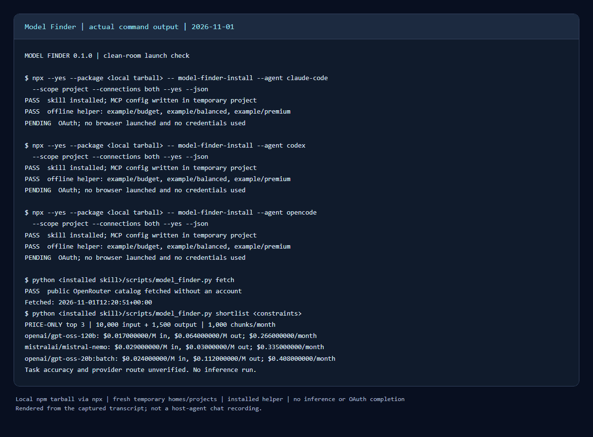

# Model Finder: live price-only demo, 2026-11-01

This is an actual run of the installed Python helper against the public OpenRouter catalog, not the synthetic fixture. **Top three by advertised token cost; task viability and provider routes are unverified.** No benchmark input was supplied, no model inference was run, and no financial documents were uploaded.

- Task: shortlist low-cost models for bulk extraction of financial metrics from already extracted text, in an application that requires tool calling and JSON Schema output.
- Hard constraints: text input, text output, `tools`, `structured_outputs`, at least 131,072 context tokens, a known output limit sufficient for 1,500 tokens, non-free pricing, and no dynamic aliases. Asynchronous `:batch` variants are allowed for this bulk workload.
- Workload assumption: 10,000 input + 1,500 output tokens per chunk; 1,000 chunks/month. These are chunks, not complete PDF files.
- Source: [OpenRouter models API](https://openrouter.ai/api/v1/models).
- Catalog fetched: **2026-11-01 12:20:51 UTC / 17:20:51 PKT**. 452 catalog entries; 275 matched the catalog-level filters.

| Price-only pick | Input USD/M | Output USD/M | USD/chunk | USD/1,000 chunks |
| --- | ---: | ---: | ---: | ---: |
| [`openai/gpt-oss-120b`](https://openrouter.ai/openai/gpt-oss-120b) | 0.017 | 0.064 | 0.000266 | 0.266 |
| [`mistralai/mistral-nemo`](https://openrouter.ai/mistralai/mistral-nemo) | 0.029 | 0.030 | 0.000335 | 0.335 |
| [`openai/gpt-oss-20b:batch`](https://openrouter.ai/openai/gpt-oss-20b:batch) | 0.024 | 0.112 | 0.000408 | 0.408 |

The third pick requires batch execution; do not use it as an interactive chat route. Catalog minimum prices can belong to different provider routes from the advertised capabilities. Before selecting a production model, verify a single eligible route and evaluate exact numeric extraction on representative statements. Missing benchmark evidence in this run is unknown, not a zero score.

Costs are input tokens × input price + output tokens × output price. They exclude extra reasoning output, caching, request/tool fees, retries, multimodal charges, and pricing tiers. Prices and ranking will change: the date above is the run date, not a promise of today's rates.

## Reproduce

From a checkout, after `npm ci --ignore-scripts`:

```bash
python scripts/launch_check.py --live
```

This packs the local source, runs its **npx** installer separately for Claude Code, Codex and OpenCode in fresh temporary homes/projects, and runs the offline helper from each installed skill. It then performs one account-free catalog fetch and the live price-only shortlist. OAuth remains pending. Raw snapshots and detailed logs are written under the ignored `.model-finder/launch/`; they are not distributed.

Or run only the helper:

```bash
python skills/model-finder/scripts/model_finder.py fetch --output .model-finder/catalog.json
python skills/model-finder/scripts/model_finder.py shortlist --catalog .model-finder/catalog.json --require structured_outputs --require tools --input-modality text --min-context 131072 --input-tokens 10000 --output-tokens 1500 --requests-per-month 1000 --exclude-free --exclude-aliases --limit 3
```

## Visual proof



The image renders the actual [command transcript](../assets/demo/model-finder-demo.txt). It shows the packaged installer and installed helper; it is **not** a recording of a host agent responding to `/model-finder` or `$model-finder`. Recording that client interaction remains a separate release check. No output or successful OAuth session is simulated.
